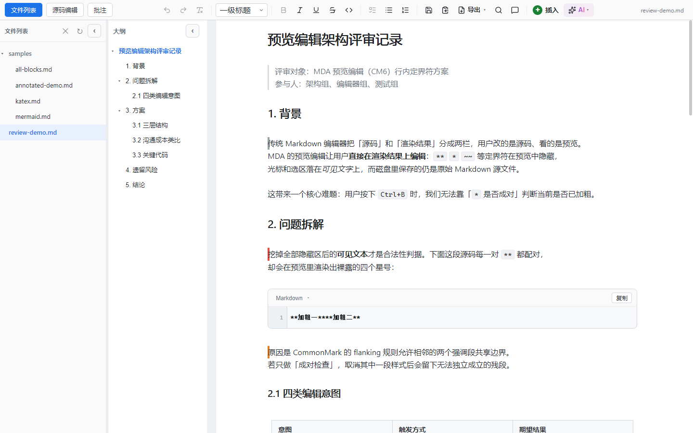
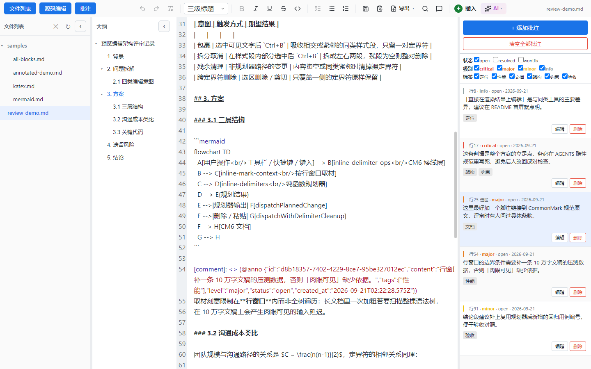
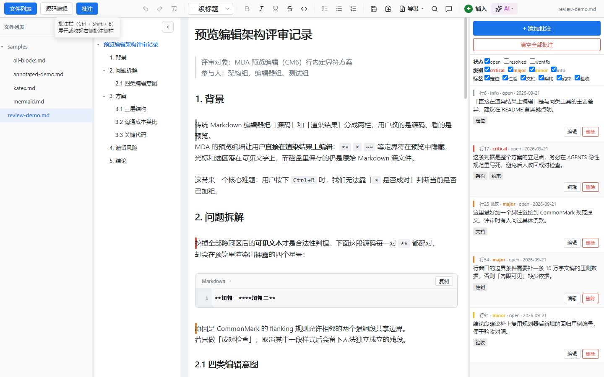
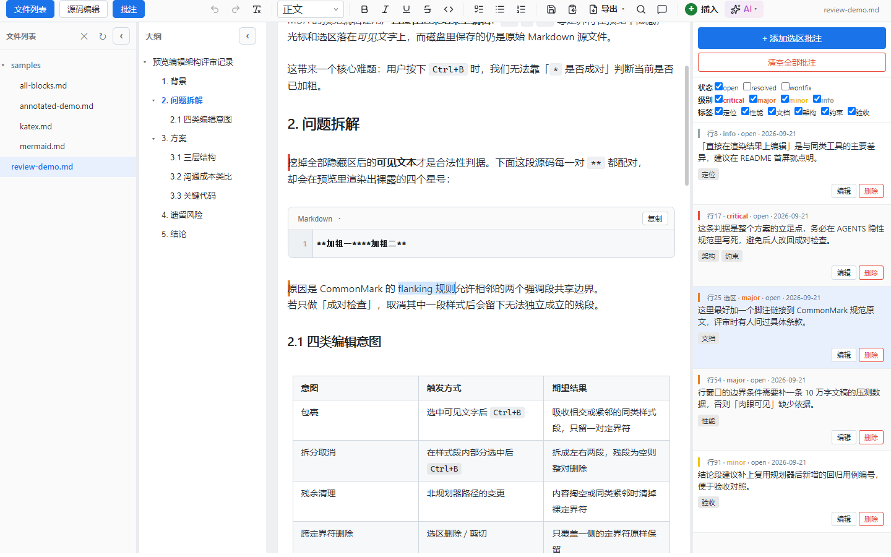
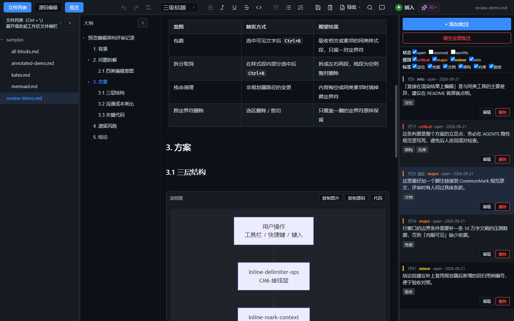
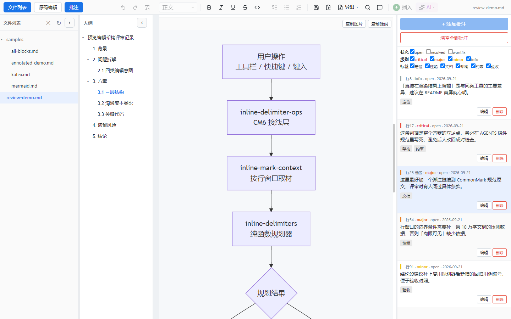

# MDA — Markdown Workbench

**Markdown editor × inline comments × export × MCP, in one local app.**
Open a `.md`, preview it, edit it in place, leave paragraph-level review comments, export to Word / PDF / WeChat, or hand it to an AI agent.

[中文完整文档](README.md) · [Download](https://github.com/ShuiYunYueKeeper/mda-l2/releases/latest) · [Website](https://shuiyunyuekeeper.github.io/mda-l2/en/) · [Quick start](#quick-start) · [FAQ](#faq)




MDA is a **local-first Markdown workbench** for people who receive `.md` files rather than live in them. It covers the whole hand-off loop — open, preview, edit a few lines, annotate, export, hand to an agent — without converting the file into someone else's private format.

Comments are stored **inside the `.md` file** as standard Markdown link reference definitions, so they are invisible in rendered views, survive a change of tools, and travel through `git diff` like any other line.

The same `@mda/core` powers three entry points: **GUI** (`mda`), **CLI** (`mda-cli`) and **MCP** (`mda-mcp`).

> **Free, no account.** v3.1.0 ships without AI or Pro/licensing entry points. Everything below works offline. Edition flags live in `src/gui/edition.js` (`ai: false` / `pro: false`).

## Why MDA

- **Comments belong to the file.** One `[comment]: <> (@anno {JSON})` line is a valid CommonMark comment. GitHub, Typora and Obsidian render nothing; `git diff` shows exactly what a reviewer asked for. Switch editors and the comments are still there.
- **Edit in the rendered view, save clean Markdown.** Type directly into the preview — emphasis, strikethrough and code delimiters are hidden while editing, and the saved file keeps the original source. Tables, fenced code and Mermaid blocks are editable in place too.
- **A complete delivery path.** Single-file HTML / PDF / Word export, plus rich text for the WeChat article editor. Local images, KaTeX formulas and Mermaid diagrams are embedded — no network needed.
- **Agents can take over.** A built-in stdio MCP server exposes six tools to scan, add, edit and remove comments, read a document with its comments, and export a review prompt. Works with Claude Desktop, Cursor and other MCP clients.

| If you need to… | MDA does |
| --- | --- |
| Review an AI-generated plan or spec | Leave paragraph- or selection-level comments that render invisibly |
| Give a colleague precise feedback on a `.md` | Comments live next to the text, and in the same git diff |
| Deliver Markdown as Word / PDF / WeChat article | One command or menu item, local assets embedded |
| Let an agent read or update review notes | Six MCP tools over stdio, scoped to a workspace directory |

## Quick start

**Desktop (recommended).** Download from [Releases](https://github.com/ShuiYunYueKeeper/mda-l2/releases/latest). Current assets are Windows x64: `MDA-3.1.0-win-x64.exe` (NSIS installer), `MDA-3.1.0-portable-win-x64.exe`, and `*-win-x64.zip`. On macOS and Linux, run from source or build your own package; the electron-builder config is included in the repo.

**From source** (Node.js ≥ 18):

```bash
npm install
npm run build
npm run gui                 # launch the GUI
npm run gui -- samples/demo.md
npm run cli -- scan samples/demo.md --format json
```

**For an agent.** Point your MCP client at `dist/mcp/server.js` — see [MCP server](#mcp-server).

## Features

### Preview editing (default mode)

MDA starts in a rendered view you can type into. The inline syntax layer is hidden while editing, so what you see is the document, not its markup; the file on disk stays plain Markdown. A delimiter planner merges adjacent styles and splits a style when you un-format part of a run, then verifies the remaining fragment still renders — no stray `****` left behind. Tables, code blocks and Mermaid source are editable in the same way. Switch to source mode from the toolbar at any time.

### Three-pane layout

Independent **Edit** and **Comments** toggles around an always-present preview; both can be open for `source | preview | comments`. Panes are resizable and double-clicking a divider restores the default width.

### Comments and review workflow

- Add, edit, delete and filter comments by status, level and tag.
- **Selection-level comments**: select text in preview or source, right-click, comment on exactly that range; the highlight and the panel entry locate each other.
- Paragraph colour bars map to severity (`critical` / `major` / `minor` / `info`).
- Default status filter is **open only**; one click clears all comments in the current file (with confirmation).
- Writes go through the core writer: atomic replace, CRLF/LF preserved, and a source-protection check that proves no body line changed.

### Export and delivery

- **HTML / PDF / Word** export from the File menu, as a self-contained file (Word via `html-to-docx`).
- **Copy for WeChat**: converts the preview to inline-styled rich text, embedding local images, Mermaid diagrams and KaTeX formulas as PNGs without scrolling or re-laying-out the page.
- **Image / diagram zoom**: click to open an overlay, 0.3×–8× wheel zoom, drag to pan, double-click to reset; copy the bitmap or the Mermaid source.

### Markdown rendering

CommonMark 0.31 + GFM tables, syntax highlighting, Mermaid diagrams (bundled offline), KaTeX math, and native HTML blocks sanitised through a whitelist. `<details>`, badges and `<p align="center">` headers render as cards instead of raw source. BOM and malformed comment lines are handled defensively so they never leak into the preview.

### Files, outline and sessions

- Workspace file tree with drag-to-move, copy, rename, delete (with confirmation), and undo for copy/move; conflicts offer overwrite / auto-rename / cancel.
- Document outline on the left of the preview, following the caret and scroll position.
- Recent files, welcome page, restore-last-session and remember-layout preferences.
- Autosave (off / on blur / every 30 s / every 60 s), dark mode, Chinese and English UI.

## CLI

```bash
mda-cli scan <file|dir> [-r] [--format table|json] [--status <s>] [--level <l>]
mda-cli add <file> <line> <content> [--tags a,b] [--level <l>] [--anchor <json>]
mda-cli edit <file> <id> [--content <c>] [--tags a,b] [--level <l>] [--status <s>]
mda-cli remove <file> <id>
```

`--format json` writes only the JSON array to stdout; every log, warning and error goes to stderr. Install globally with `npm install -g .` to get `mda-cli` and `mda-mcp` on `PATH`.

## MCP server

The stdio server exposes six tools with the same semantics as the CLI. The workspace root comes from `MDA_WORKSPACE` or `--workspace`; write paths must stay inside it.

```json
{
  "mcpServers": {
    "mda": {
      "command": "node",
      "args": ["D:/mda-l2/dist/mcp/server.js", "--workspace", "D:/my-docs"]
    }
  }
}
```

| Tool | Purpose |
| --- | --- |
| `mda_scan` | Scan comments; same JSON as `mda-cli scan --format json` |
| `mda_add` | Add a comment (supports `anchor`) |
| `mda_edit` | Edit a comment |
| `mda_remove` | Remove a comment |
| `mda_read_file` | Read a file plus its `parseAnnotations` result |
| `mda_export_review_prompt` | Aggregate comments from multiple files into a review prompt |

## Comment syntax

```markdown
[comment]: <> (@anno {"id":"<UUID>","content":"Tighten this paragraph","tags":["clarity"],"level":"major","status":"open","created_at":"2026-06-26T00:00:00+08:00"})
The paragraph being reviewed.
```

A comment belongs to the first body paragraph **below** it; blank lines in between do not break the association. Comments at the end of a file with no following body are kept as orphans.

| Field | Type | Meaning |
| --- | --- | --- |
| `id` | UUID string | Stable identifier |
| `content` | string | Comment text |
| `tags` | string[] | Free-form labels |
| `level` | `critical` / `major` / `minor` / `info` | Severity |
| `status` | `open` / `resolved` / `wontfix` | Review state |
| `created_at` | ISO 8601 | Creation time |

Because the line is a standard Markdown comment, other tools ignore it and GitHub's rendered file view shows nothing. In a PR diff the `@anno` JSON is visible — comments and code changes stay in one review.

## Screenshots

| Preview editing | Source mode |
| --- | --- |
|  |  |

| Comments panel | Selection comment |
| --- | --- |
|  |  |

| Dark mode | Mermaid and code |
| --- | --- |
|  |  |

More in [`docs/screenshots/README.md`](docs/screenshots/README.md).

## Build and test

```bash
npm run build      # tsc + editor bundle + GUI assets
npm test           # Jest with coverage
npm run coverage   # coverage/lcov-report/index.html
npm run dist:win   # NSIS + portable + zip (run on Windows)
```

Build order matters: `build:ts` produces `dist/core`, which the GUI preload requires, so build before launching the GUI. Packaging details (signing, SmartScreen, auto-update) are in [`docs/packaging-windows.md`](docs/packaging-windows.md).

## FAQ

**Does a comment break Markdown compatibility?**
No. It is a CommonMark link reference definition; renderers produce no output for it. Tools that do not recognise the `@anno` payload treat it as an ordinary reference line. The CLI and GUI can remove every comment without touching a single body line.

**How is this different from Typora, Obsidian or VS Code?**
Those are a writing tool, a knowledge base and a general editor. MDA targets the step after you receive a `.md`: understand it, change a few lines, leave structured feedback, export what the other side needs, then hand it to an agent. Comments living in the file and MCP being a first-class entry point are the practical differences.

**Which platforms are supported?**
Windows (installer, portable, zip), macOS (dmg, zip) and Linux (AppImage, deb). macOS and Linux packages must be built on their own platform; the electron-builder config is in the repo. Windows builds are attached to Releases.

**Is it really free?**
Yes. MIT-licensed, all v3.1.0 features available, no account, activation, telemetry or paid AI tier.

**Are my documents uploaded?**
No. The app only reads and writes the files you open; preview, export and WeChat copy run locally. The MCP server is restricted to paths under its `--workspace`.

**Can I see comments on GitHub?**
Not in the rendered file view — that is the point. In the source view or a PR diff the `@anno` JSON is visible, so review notes and code changes are reviewed together.

## Contributing

If MDA saves you a few round-trips between tools, **a ⭐ Star** is the most useful support; sharing it with someone who also keeps receiving `.md` files helps too.

Read [`AGENTS.md`](AGENTS.md) before contributing (architecture layers, core interfaces, coding rules and hard constraints). Issues and feature requests: [GitHub Issues](https://github.com/ShuiYunYueKeeper/mda-l2/issues).

## License

[MIT](LICENSE) © 2026 MDA
